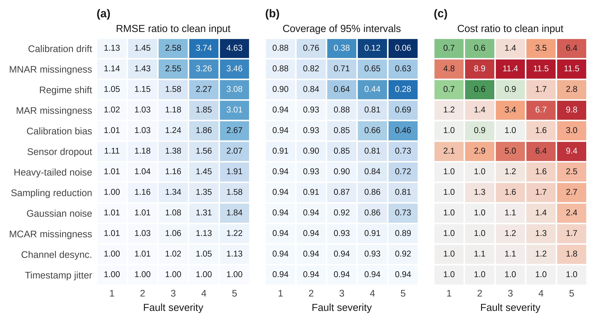
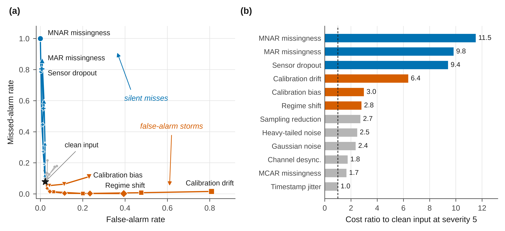

# DQ-Twin-Bench

**A severity-graded benchmark of sensor data-quality faults for deep-learning prognostics.**

[](LICENSE)
[](LICENSE-DATA.md)


This repository accompanies the paper

> G. Alam, "Sensor data quality and the reliability of deep-learning prognostics: a severity-graded benchmark of accuracy, uncertainty and maintenance decisions", manuscript under review, 2026.

Deep-learning models for remaining useful life (RUL) are trained on clean sensor records but run on streams whose quality degrades. DQ-Twin-Bench measures what that degradation does to three things at once: prediction error, the coverage of conformal prediction intervals, and alarm-based maintenance decisions.

## What is in the benchmark

| Element | Setting |
|---|---|
| Data | NASA C-MAPSS turbofan subsets FD001 to FD004 |
| Models | LSTM, 1D-CNN and Transformer, five training seeds each (60 models) |
| Uncertainty | Monte Carlo dropout (30 passes) with split-conformal calibration at 95% |
| Faults | 12 inference-time faults: noise, heavy-tailed noise, calibration bias, calibration drift, MCAR, MAR and MNAR missingness, sensor dropout, timestamp jitter, channel desynchronisation, sampling reduction, regime shift |
| Severities | 5 levels per fault, 10 injection seeds per level |
| Size | 36,000 corrupted evaluations plus 60 clean references |
| Metrics | RMSE, MAE, R2, PHM08 score, interval coverage and width, false-alarm rate, missed-alarm rate, maintenance cost |

## Main results

| Finding | Evidence |
|---|---|
| Calibration drift is the most damaging fault | It ranks first in all 12 subset and architecture combinations. RMSE rises by a factor of 2.4 to 2.9 on average and up to 5.2 at the highest severity. |
| Gaussian noise is comparatively mild | It ranks ninth of twelve, with RMSE up by 19% to 33%. |
| The missingness mechanism matters more than the rate | Data missing not at random (MNAR) raises the missed-alarm rate from 0.08 to 0.99. Random loss of half the samples raises it to 0.14. |
| Conformal intervals fail without warning | Nominal 95% intervals cover 6% of engines under severe drift and shrink to 24% of their clean width. |
| Faults split into two decision failure modes | Drift, bias and regime shift cause false alarms. MNAR loss, MAR loss and sensor dropout cause missed alarms. |



*RMSE ratio, interval coverage and maintenance cost ratio for each fault and severity, pooled over subsets, architectures and seeds.*



*False-alarm rate against missed-alarm rate as severity grows, and the cost ratio at severity 5.*

## Repository layout

```
dq-twin-bench/
├── analysis/                 scripts that rebuild every table, figure and quoted number
│   ├── dqtb.py               shared loaders and statistics
│   ├── make_tables.py        Tables 2 and 4 to 10, Table A.1
│   ├── make_figures.py       Figs. 1 to 10
│   └── verify_claims.py      108 checks of the numbers quoted in the paper
├── benchmark/                training and fault-injection code (see "Status" below)
├── configs/                  experiment configuration written by the benchmark run
├── data/                     processed C-MAPSS windows and instructions for the raw data
├── docs/                     fault taxonomy and metric definitions
├── figures/                  generated figures, plus the per-subset supplementary figures
├── results/                  raw results of all 36,000 evaluations and the rebuilt tables
├── tests/                    integrity tests for the released results
└── reproduce.py              runs the whole analysis in one step
```

## Quick start

```bash
git clone https://github.com/YOUR-USERNAME/dq-twin-bench.git
cd dq-twin-bench
python -m venv .venv
# Windows:        .venv\Scripts\activate
# macOS / Linux:  source .venv/bin/activate
pip install -r requirements.txt
python reproduce.py
```

`reproduce.py` rebuilds the tables in `results/tables/`, the figures in `figures/`, and then checks the numbers quoted in the paper. It needs no GPU and finishes in under a minute.

The three steps can also be run one at a time:

```bash
python analysis/make_tables.py
python analysis/make_figures.py          # add "--dpi 200" for a faster run, or "4 8" for single figures
python analysis/verify_claims.py
```

## Working with the results

Each row of `results/sweep_v2_FD00x.csv` is one evaluation of one trained model under one fault, severity and injection seed. `results/baseline_clean_v2.csv` holds the clean-input reference for each model. The column dictionary is in [results/README.md](results/README.md).

```python
import sys
sys.path.insert(0, "analysis")
import dqtb

sweep, baseline, merged = dqtb.load_all()

# Corruption Robustness Index: RMSE under a fault divided by clean RMSE
cri = dqtb.cri(merged, ["corruption"]).groupby(["corruption", "model"]).mean().unstack()
print(cri.loc[dqtb.ORDER].round(2))
```

To compare your own model with the published ones, evaluate it under the same faults, write its results in the same column layout, and append them to the sweep before calling the functions in `dqtb.py`.

## Documentation

- [Fault taxonomy](docs/fault_taxonomy.md): the twelve faults, their codes in the CSV files and their severity parameters
- [Metrics](docs/metrics.md): definitions of every reported quantity
- [Data](data/README.md): how to obtain C-MAPSS, file checksums and the processed arrays
- [Results](results/README.md): files and column dictionary

## Status

| Component | State |
|---|---|
| Raw results of all 36,000 evaluations | Released |
| Experiment configuration, seeds and training metadata | Released |
| Processed C-MAPSS windows | Released |
| Analysis code for all tables and figures | Released |
| Training and fault-injection code | Being prepared for release in `benchmark/` |

## Citation

If you use the benchmark, its results or its code, please cite the paper. GitHub shows a "Cite this repository" button generated from [CITATION.cff](CITATION.cff).

```bibtex
@unpublished{alam2026dqtwinbench,
  author = {Alam, Gulzar},
  title  = {Sensor data quality and the reliability of deep-learning prognostics: a severity-graded benchmark of accuracy, uncertainty and maintenance decisions},
  note   = {Manuscript under review},
  year   = {2026}
}
```

The C-MAPSS data should be credited to its authors: A. Saxena, K. Goebel, D. Simon and N. Eklund, "Damage propagation modeling for aircraft engine run-to-failure simulation", International Conference on Prognostics and Health Management, 2008, https://doi.org/10.1109/PHM.2008.4711414.

## License

Code is released under the [MIT License](LICENSE). Results, tables and figures are released under [CC BY 4.0](LICENSE-DATA.md). The C-MAPSS data belong to NASA and are not covered by these licenses.

## Contact

Dr. Gulzar Alam, Ulster University, g.alam@ulster.ac.uk. Questions and bug reports are welcome through GitHub issues.
